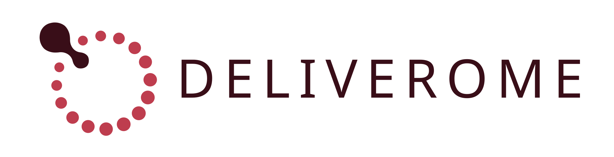

  

**Targeted delivery has a bottleneck.** To get a medicine into the right cells, you need a surface protein that is on those cells and not on the wrong ones, is there at a useful level, brings cargo inside, and sends it somewhere it can do its job. Most of that has never been measured. What exists is scattered across disconnected datasets, labs, and proprietary systems.

The Deliverome Project is a nonprofit startup building an open atlas of the human surfaceome to change that. We're measuring four things across tissues, cell types, and disease states:

- **Abundance and specificity.** What matters for delivery is protein on the cell surface, and RNA atlases routinely disagree with it. We measure surface protein directly by mass spectrometry, with both global DIA proteomics and glycoprotein enrichment.
- **Internalization.** A surface protein only helps if it brings cargo inside. We rank internalization across the surfaceome with enrichment-based mass spectrometry and pooled, barcoded functional-genomics screens.
- **Routing.** Once inside, does cargo go to the endosome, the lysosome, or back to the surface? The same pooled screens map where each surface protein sends it.
- **Functional delivery.** Does a real payload, such as an siRNA or a toxin, reach its target and work? This is what tells us whether the atlas predicts delivery.

### How we work

We share our data, methods, and reagents openly, and we collaborate across academia and industry. Our derived data is released to the public domain where we hold the rights, and our code is open source; each repository's `LICENSE` and `CITATION.cff` give the details. We publish the tables and scripts behind our figures, and archive releases on Zenodo so you can cite the exact version you used.

### Start here

- 🌐 [deliverome.org](https://deliverome.org): the project, the platform, and the team
- 🔬 [Surfaceome viewer](https://surfaceome.deliverome.org): browse the atlas protein by protein
- 📄 [The accessible human surfaceome](https://deliverome.org/paper/accessible-surfaceome): the paper behind the atlas
- ✍️ [Substack](https://deliverome.substack.com): dataset releases, methods notes, and updates

### Repositories

**Data and atlases**
- [`accessible-surfaceome`](https://github.com/Deliverome-Project/accessible-surfaceome): an open atlas of which human proteins reach the cell surface, and in what context, with a browsable viewer, a JSON API, and a literature citation behind every call
- [`deliverome-surfaceome-library-v1`](https://github.com/Deliverome-Project/deliverome-surfaceome-library-v1): a barcoded, epitope-tagged ORF library of human cell-surface proteins, with its design brief and an offline reproduction of every design decision

**Analysis tools**
- [`agentflow`](https://github.com/Deliverome-Project/agentflow): reproducible flow cytometry analysis with FlowKit, a CLI, and optional Matplotlib gate editing
- [`limpa-rs`](https://github.com/Deliverome-Project/limpa-rs): Rust-accelerated LIMPA protein quantification with a pinned R reference and Python interface (release candidate)

**Writing**
- [`deliverome-blog`](https://github.com/Deliverome-Project/deliverome-blog): the code and data behind our Substack posts

📬 Questions, collaborations, or data requests: [contact@deliverome.org](mailto:contact@deliverome.org)
